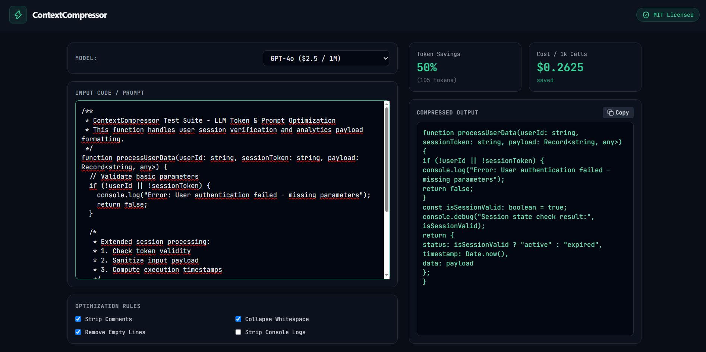

# ⚡ ContextCompressor

> Minify source code and prompts before hitting the OpenAI API to reduce token consumption and latency.



🔗 **Live Demo:** [https://llm-context-compressor.netlify.app](https://llm-context-compressor.netlify.app)

---

## 🎯 The Problem

When developers pass raw source code, large JSON schemas, or long system prompts to LLMs like `gpt-4o`, up to **20% to 40% of the token payload is wasted** on non-semantic overhead. Comments, redundant whitespace, empty lines, and internal debugging logs consume context window space and increase per-request API costs without adding value to the model's output.

## 💡 The Solution

`ContextCompressor` is a client-side developer tool built to strip out zero-value context before sending requests to OpenAI endpoints. By processing snippets locally prior to API dispatch, it preserves code syntax while minimizing overall token footprint.

### Key Features

- **Real-Time Token & Cost Analysis:** Live token estimation and dollar savings breakdown based on current OpenAI pricing models (`gpt-4o`, `gpt-4o-mini`, `gpt-4-turbo`).
- **Configurable Minification Rules:** Tweak optimization pipelines on the fly (comment stripping, whitespace collapsing, empty line removal, and console log cleanup).
- **Privacy-First Architecture:** Runs 100% on the client side. No code snippets or API payloads are logged or transmitted to external servers.

---

## 🚀 Quick Start

### Installation

Clone the repository and install dependencies:

```bash
git clone [https://github.com/baranejder/llm-context-compressor.git](https://github.com/baranejder/llm-context-compressor.git)
cd llm-context-compressor
npm install
